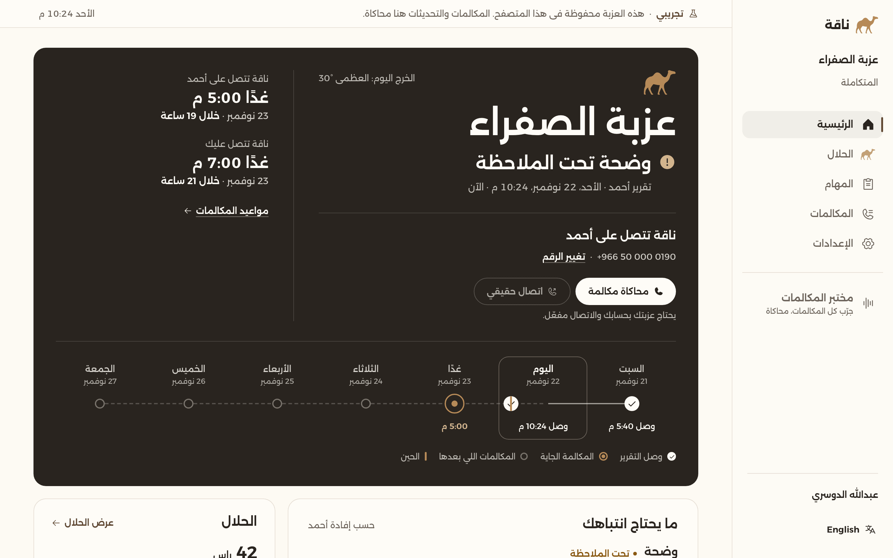
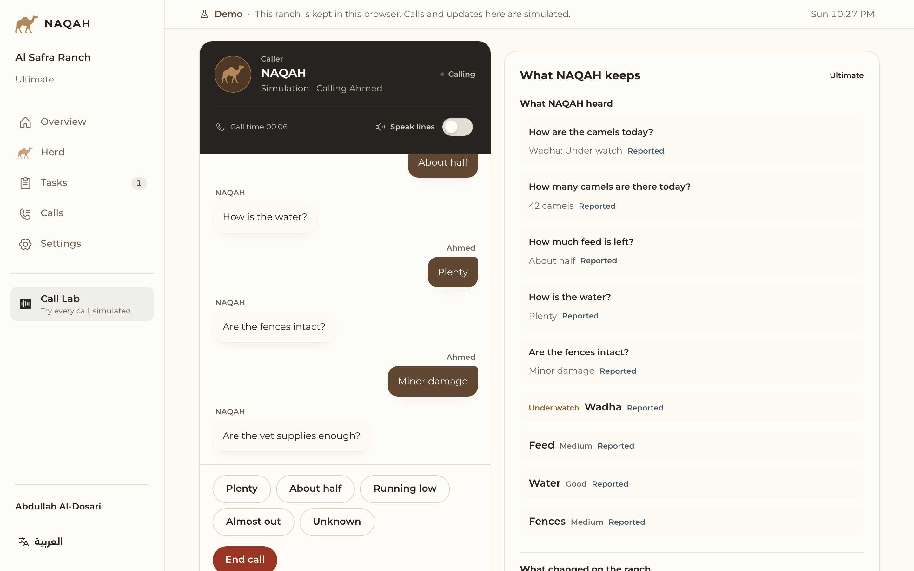
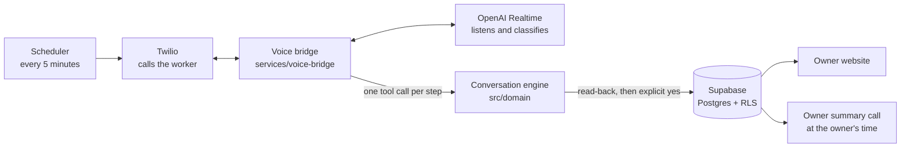
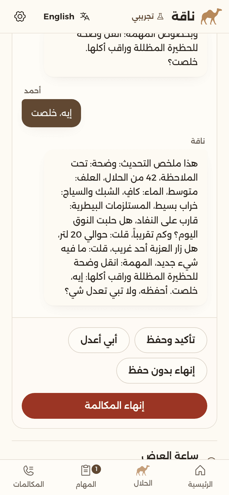
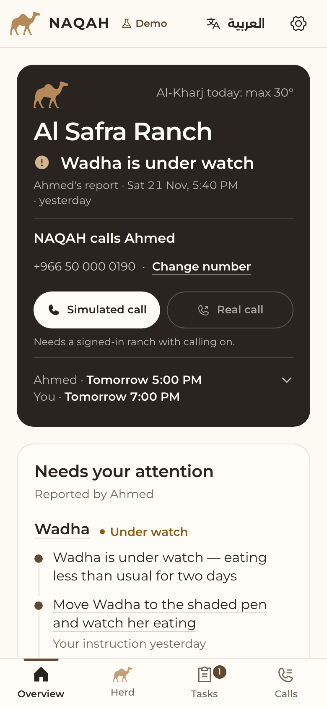
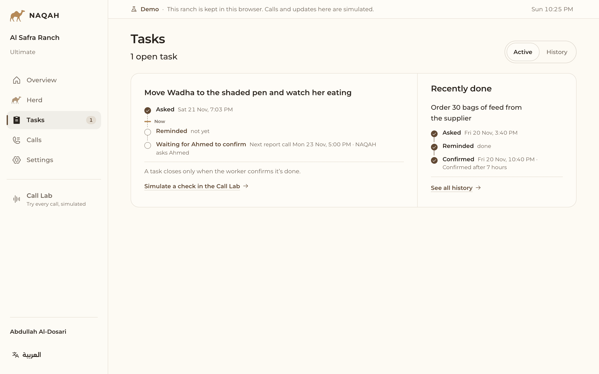
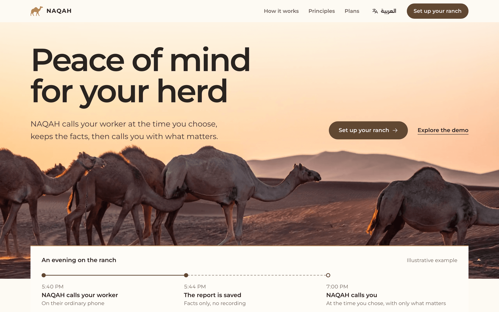

# NAQAH | ناقة

**A camel ranch's report, taken by phone, with only what matters passed to the owner.**

Camel owners rarely live on the ranch, and the worker who does is busy, often without a smartphone. NAQAH calls the
worker on an ordinary phone, asks the owner's questions one at a time and keeps the facts, never the audio. At the
owner's own time it calls the owner with what matters, and the owner follows the ranch, the herd and open tasks on a
website in Arabic or English.

[Live demo](https://naqah.vercel.app/en) · [العربية](https://naqah.vercel.app/ar) · Status: investor MVP (November 2026)

<p align="center">
  
</p>

## Try it in 60 seconds

1. Open [naqah.vercel.app/en](https://naqah.vercel.app/en) and press **Explore the demo**. You land on a sample ranch.
2. Read the **Overview**: one sentence on how the ranch is doing, the week's report rhythm and what needs attention.
3. Open **Call Lab**, choose the report call and press **Call Ahmed now**, then **Answer**. Reply in your own words,
   or say "I don't know". The facts appear beside the phone under **What NAQAH keeps**.
4. Listen to the read-back and answer yes. Nothing is saved before that.
5. Go back to **Overview** for the new report, then **Tasks** for a task waiting on the worker's confirmation.
6. Switch to العربية. The product is Arabic-first and right to left.

The public demo runs entirely in your browser. No call is placed, nothing is charged, and nothing leaves the browser.

<p align="center">
  
</p>

## How a call works



- **The model listens, the server speaks.** The model only classifies what the worker said. Question order,
  follow-ups and every spoken word come from the engine in `src/domain/conversation`.
- **Saved only after a yes.** The worker hears every recorded detail read back, can correct it, and the report is saved
  only after an explicit yes. A thank-you is not a yes.
- **Calm retries.** A report call that is not completed is tried three times, 20 minutes apart, then marked missed.
  The owner's summary call follows the same rule and still happens when no report arrived, saying so plainly.
- **Facts, not recordings.** Recording and transcription storage stay off. Each fact is labelled reported,
  approximate, unknown or verified, and anything the worker did not mention is saved as not reported.
- **Emergencies skip NAQAH.** The worker calls the owner directly. NAQAH never diagnoses.

<p align="center">
  
  
</p>

## Simulated or real

| Part | Public demo | Built, off in production. Turned on by |
|---|---|---|
| Owner website (ar/en) | Real; sample ranch kept in `localStorage` | Accounts: `NEXT_PUBLIC_NAQAH_ACCOUNT_DATA=1` with `NEXT_PUBLIC_SUPABASE_URL` and `NEXT_PUBLIC_SUPABASE_PUBLISHABLE_KEY` |
| Report call to the worker | Simulated in Call Lab | `NAQAH_VOICE_MODE=farm`, the `TWILIO_*` variables, `SUPABASE_SECRET_KEY`, `NAQAH_CALL_ALLOWLIST` |
| Natural speech | Scripted engine in the browser | `NAQAH_VOICE_ENGINE=realtime`, `NAQAH_BRIDGE_PUBLIC_URL`, `OPENAI_API_KEY` on the bridge |
| Owner's "Call now" | Explains it needs a signed-in ranch | `NAQAH_MANUAL_REPORT_CALLS=1` |
| Scheduled calls | A demo clock you can move forward | `CRON_SECRET`, `NAQAH_SCHEDULED_CALLS=1`, the pg_cron migration |
| Owner summary call | Simulated in Call Lab | `NAQAH_CALL_OWNER=1` |
| AI Voice Lab | Not shown | `NAQAH_VOICE_LAB=1`, `NAQAH_VOICE_LAB_OWNERS` |
| Payments | Prices shown only | Not built |

Every variable is described in [`.env.example`](.env.example), with paid and secret ones marked. Unset means off.
The scheduler and worker-claim migrations are not yet applied to the hosted database.

## Plans

| | Basic | Ultimate |
|---|---|---|
| Report call to the worker | once a week, at the owner's day and time | once a day, at the owner's time |
| Registered workers | up to 3 | up to 10 |
| Custom questions | up to 5 | unlimited |
| Owner summary call | weekly | daily, plus spoken instructions confirmed on a read-back |
| Task tickets | none | close only when the worker confirms |

Displayed prices are SAR 299 (Basic) and SAR 999 (Ultimate) per ranch per month before VAT. The MVP takes no payments.

<p align="center">
  
</p>

## Tech stack

Next.js 16 (App Router) · React 19 · TypeScript · Tailwind CSS v4 · zustand · Supabase (Postgres, Auth, RLS,
pg_cron) · Twilio Programmable Voice · OpenAI Realtime through a Node voice bridge · Vitest and Playwright · Vercel.

## Repository layout

```
src/domain/             pure business rules and the conversation engine (no React, no storage)
src/app/[locale]/       pages: landing, onboarding, owner dashboard, Call Lab
src/app/api/            voice webhooks, scheduler, account and test-call routes
src/server/             Supabase persistence, call placement, voice contract
src/components/         design-system primitives and page building blocks
src/i18n/               Arabic and English messages, Riyadh time, Latin digits
services/voice-bridge/  Twilio media stream to OpenAI Realtime, hosted outside Vercel
supabase/migrations/    production schema with row-level security
```

Every rule is a pure function in `src/domain`, so the browser demo, the webhooks and the scheduler run the same code.
2,803 Vitest tests pass (162 more are skipped without a local Postgres or a live model), plus 134 voice-bridge tests.
The handbook for contributors is [`AGENT.md`](AGENT.md).

## Run locally

```bash
npm install
npm run dev          # http://localhost:3000, redirects to /ar
npm test             # domain rules, call engine, server routes, voice bridge
npm run typecheck
npm run lint
npm run build
```

The demo needs no environment variables and no accounts.

## Real calling

Real calls need a Twilio account, a hosted voice bridge, an OpenAI key and a Supabase project. Each costs money and
needs the owner's approval. Follow [docs/integrations/go-live-checklist.md](docs/integrations/go-live-checklist.md)
in order. The [voice bridge README](services/voice-bridge/README.md) and
[realtime-voice.md](docs/integrations/realtime-voice.md) explain the call path.

## Status and limitations

- Investor MVP. There are no production customers.
- Real calling, accounts and scheduling are built and tested locally, mostly against mocked providers, with a small
  number of supervised test calls. They are off on the public site.
- One owner, one ranch. No native app, no worker app, no website chatbot.
- Arabic speech recognition on real phone lines is still being tuned.
- Not a veterinary tool: NAQAH records what the worker reports and never diagnoses.
- Open product decisions are listed in [`AGENT.md` §7](AGENT.md#7-open-decisions-do-not-treat-as-approved).

<p align="center">
  
</p>

## Credits

The landing and onboarding photographs come from Pexels, Unsplash and Wikimedia Commons, each under its own licence
(Pexels, Unsplash and Creative Commons). Creators, titles, sources and terms are listed in
[docs/design/asset-ledger.md](docs/design/asset-ledger.md). Share-alike photographs are used unaltered.

## License

The code is released under the [MIT License](LICENSE).

The MIT licence does not cover:

- the NAQAH name and the camel mark (`public/brand`, `src/components/brand`), which may not be reused to identify
  another product;
- the photographs in `public/images`, each of which stays under its own licence as recorded in the
  [asset ledger](docs/design/asset-ledger.md).
